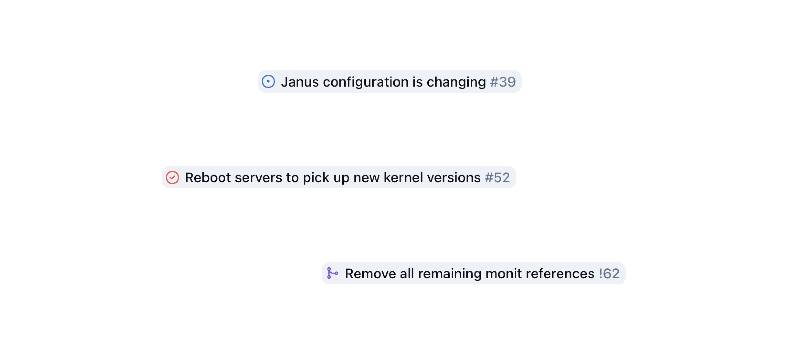

Outline now integrates with [Gitea](https://about.gitea.com) and [Forgejo](https://forgejo.org), bringing the same rich previews already available for GitHub and GitLab to teams that host their own code. Paste a link to an issue, pull request, or repository into a document and choose "mention" to show its live details inline.

- **Issues and pull requests** – see the current status, author, and labels at a glance, including whether a pull request is a draft or merged, and hover for a preview of the description
- **Repositories** – mention a repository to show its owner, description, topics, visibility, and progress through its issues
- **Always up-to-date** – mentions refresh automatically as issues and pull requests change in Gitea or Forgejo
- **Self-hosted friendly** – connect any instance, and connect multiple instances if your team runs more than one
